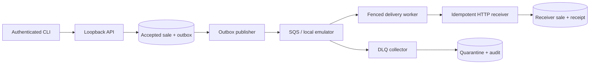

# AWS retail integration

[](https://github.com/DmitryLyubaev/aws-retail-integration/actions/workflows/ci.yml)

A bounded synthetic portfolio demonstration: a completed POS sale reaches a
simulated accounting receiver once as a durable business effect, despite duplicate
submissions, retries and selected process crashes.

TypeScript/Node 24, Fastify, PostgreSQL 17, SQS-compatible queues and Linux
containers. AWS definitions use ECS/Fargate, SQS and a small private RDS instance.
There is an authenticated API and CLI.

## Run the offline demonstration

With Docker and Compose available:

```sh
docker compose --profile test build tooling
docker compose --profile test run --rm tooling npm run check
docker compose --profile test run --rm tooling npm run demo:offline
```

On this Windows workstation, prefix Docker commands with
`wsl -d Ubuntu --cd /mnt/e/Projects/aws-retail-integration --`.
The harness uses real PostgreSQL, ElasticMQ and HTTP. It creates isolated synthetic
databases/queues and tests actual process crashes. Private raw receipts stay in
ignored `results/`; a dated summary is written to
[the offline report](docs/offline-report.md).

The declared sample is 200 unique sales and 40 duplicate submissions, across two
tenants at five submissions/second with at most five concurrent requests. It also
restores the delivered dataset into a separate logical database and checks every
table hash, grants and deduplication. Observed latency/CPU figures describe this
one local sample.

To smoke the built runtime image, including every dispatcher mode:

```sh
docker build --target runtime -t p14-runtime:offline .
docker compose -f compose.yaml -f compose.image.yaml --profile test run --rm tooling npm run test:one -- tests/integration/image.test.ts
```

The image-test override gives only that local test container access to the Docker
socket so it can create and remove its own named smoke-test containers. Ordinary
application checks do not mount it. API/receiver/worker run with their separate
runtime SQL roles; maintenance operations use explicit owner access.

## Behaviour demonstrated

- Strict sale validation, exact integer minor-unit totals and original byte retention.
- Transactional acceptance/outbox, tenant-scoped identity and immutable conflict handling.
- Fenced delivery leases, five bounded attempts, absolute deadlines and durable receiver receipts.
- Transient/permanent faults, committed-but-lost replies, competing workers and DLQ quarantine.
- Authenticated failed-delivery replay with a stable business identity and request idempotency.
- Redacted logs, five session metrics, declared load and isolated logical restore.



The network can deliver more than once. Durable receiver uniqueness provides one
sales effect per tenant/business identity. Ambiguous outcomes remain explicitly
unconfirmed when they cannot be reconciled within the budget.

## Operator interface

`node dist/src/main.js` dispatches `api`, `receiver`, `worker`, `migrate`, `seed`,
`cli`, `backup`, `load` and `evidence`. Tokens come from environment or a private
credential file. Product CLI commands use authenticated HTTP:

```sh
node dist/src/main.js cli submit --file fixtures/cases.json --json
node dist/src/main.js cli list --json
node dist/src/main.js cli show --id DELIVERY_UUID --json
node dist/src/main.js cli fault --sale SALE-0001 --mode reject_422
node dist/src/main.js cli fault --sale SALE-0001 --mode accept
node dist/src/main.js cli replay --id DELIVERY_UUID --generation 1 --request-id replay-1
```

See [the demo guide](docs/demo.md), [architecture and limits](docs/architecture.md)
and [verification record](docs/verification.md).

## AWS status and scope

The [29 October 2026 live report](docs/live-report.md) records one synthetic AWS
sample: 240 submissions produced 200 receiver effects with zero errors/retries,
5.02 submissions/second and 37.4 ms API p95. Real SQS redrive, a CloudWatch alarm
transition, crash/replay/fencing checks and an isolated logical restore passed.
Owned teardown required recovery and passed an independent twelve-category
recheck. Settled gross billing remains pending. Measurements and limits are
separate from the [offline report](docs/offline-report.md).

[The AWS runbook](docs/runbook-aws.md) retains the bounded owner approval and
cleanup contract. Hosted offline CI runs on pushes; paid deployment remains an
explicit protected workflow action.

This is a personal synthetic learning/CV demonstration. It excludes real payments,
customer data, an accounting ledger, production availability promises and commercial
AWS-tenure claims. It shares one database server and uses private HTTP for the
receiver. There is no database RLS or end-to-end receiver TLS claim.
